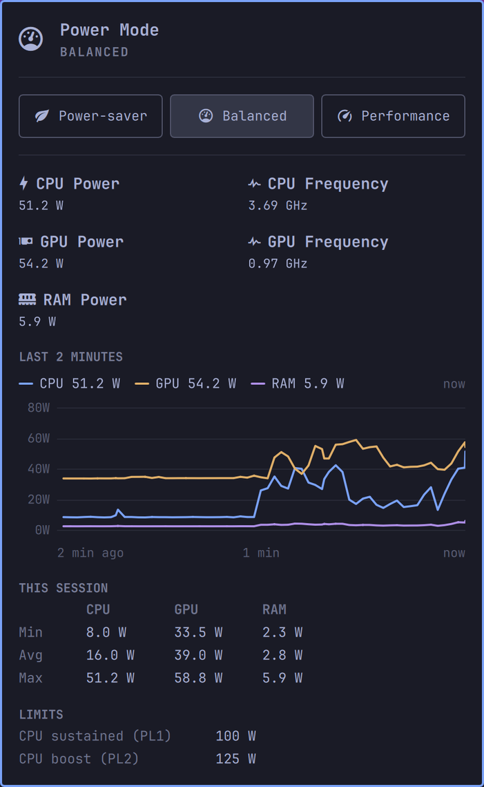

# omarchy-power-widget

[](LICENSE)
[](https://omarchy.org/)
[](manifest.json)

Plugin id: `marionuevo.power` (see `manifest.json`).

Omarchy bar widget for desktops (no battery). The bar shows live CPU package
power draw (watts, via Intel RAPL) and, on machines with an NVIDIA GPU (or an
iMac15,1 running `imac-fand`, see below), live GPU power next to it; where RAPL has a `dram` zone (Haswell desktops
such as an iMac15,1), RAM power as well. Click any of them for the
power-profile picker (power-saver / balanced / performance) and session
power stats — per-device min/avg/max, CPU PL1/PL2, GPU power cap and RAM
power cap (while one is enabled), and current CPU/GPU frequency (with the
GPU's P-state).

The GPU half is optional: with no GPU reading available, `omarchy-gpu-power`
prints nothing and every GPU element hides itself, leaving the original
CPU-only layout.

Monochrome by design — the icon and its "near/over limit" outline always use
the bar's own foreground color, never a separate hue. Near the sustained
(PL1) limit it gains a static outline; at or over it, the outline pulses.

Cloned from the built-in `omarchy.power` panel and stripped of everything
battery-specific (it hides itself entirely on hardware with no battery,
since it's gated on `UPower.displayDevice.isPresent`).



## Runtime dependencies

`Panel.qml` shells out to three commands that must be on `PATH`
(`~/.local/bin` works):

- `omarchy-cpu-power` — prints Intel RAPL's raw energy counters: a
  monotonic timestamp in ns, then CPU package energy in µJ, then (where RAPL
  has a `dram` zone, as on Haswell desktops) RAM energy in µJ and the RAM
  power limit in W. The widget turns two consecutive readings into the
  average draw over its 2 s poll; a 200 ms sample taken at each poll kept
  catching the CPU waking up for the bar's own processes and read twice the
  real figure. This is a thin wrapper (`scripts/omarchy-cpu-power`) around
  `omarchy-cpu-power-helper`, a small compiled binary
  (`scripts/omarchy-cpu-power-helper.c`).
- `omarchy-cpu-freq` — prints average current CPU frequency in MHz across
  all logical cores (`scripts/omarchy-cpu-freq`, plain shell, no special
  privilege needed — `scaling_cur_freq` is world-readable).
- `omarchy-gpu-power` — prints one CSV line
  (`watts,sm_mhz,limit_watts,pstate,util_percent`) from a single `nvidia-smi`
  query (`scripts/omarchy-gpu-power`). No special privilege needed;
  `nvidia-smi`'s read-only queries are open to any user. Without
  `nvidia-smi` it falls back to the `gpuWatts` that
  [`imac-fand`](https://github.com/marionuevo/omarchy-imac-stats) publishes
  in `/run/imac-fan/status.json`: on the iMac15,1's Southern Islands Radeon
  `amdgpu` reports no power, but the Apple SMC measures the GPU rail (key
  `PGTR`). The clock comes from `amdgpu`'s hwmon; power cap, P-state and
  utilization are left empty and hidden. Prints nothing and exits 0 when
  neither source has a reading, which is what hides the widget's GPU half.

### Why a compiled helper for power draw

The RAPL energy counters (`/sys/class/powercap/intel-rapl:*/energy_uj`) are
root-only by default (kernel hardening against a timing side-channel).
Rather than widening that permission system-wide with a udev rule, the
helper binary carries the `cap_dac_read_search` capability via `setcap`, so
only that one small, single-purpose binary (reads only these fixed sysfs
paths, takes no arguments) can bypass the read restriction — the same
mechanism `btop` uses for its own CPU-watts display.

### Install

```sh
cc -O2 -o ~/.local/bin/omarchy-cpu-power-helper scripts/omarchy-cpu-power-helper.c
sudo setcap cap_dac_read_search=ep ~/.local/bin/omarchy-cpu-power-helper
cp scripts/omarchy-cpu-power scripts/omarchy-cpu-freq scripts/omarchy-gpu-power ~/.local/bin/
chmod +x ~/.local/bin/omarchy-cpu-power ~/.local/bin/omarchy-cpu-freq ~/.local/bin/omarchy-gpu-power
```

`setcap` is stored as a filesystem extended attribute — it needs to be
re-applied any time the binary is rebuilt or copied somewhere new.
